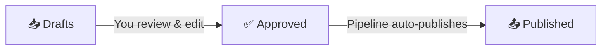

# 📊 AutoBlog Dashboard

> Last updated: {{date}}

## Quick Links
- [[📥 Drafts/en/|English Drafts]]
- [[📥 Drafts/hi/|Hindi Drafts]]
- [[✅ Approved/en/|Approved (EN)]]
- [[✅ Approved/hi/|Approved (HI)]]
- [[📤 Published/en/|Published (EN)]]
- [[📤 Published/hi/|Published (HI)]]
- [[🔬 Research/|Research Notes]]
- [[🔑 Keywords/|SEO Keywords]]
- [[📊 Logs/daily/|Daily Logs]]

## Workflow

### How to use:
1. **Check Drafts** — New AI-generated posts appear here daily
2. **Review & Edit** — Read, fix errors, add your expertise
3. **Approve** — Move the file from `📥 Drafts/en/` to `✅ Approved/en/`
4. **Wait** — The pipeline publishes within 30 minutes
5. **Verify** — Check `📤 Published/` and the live site

### Tips
- Always fact-check AI-generated content before approving
- Add personal anecdotes and opinions to make posts unique
- Check the Keywords folder for SEO ideas
- Review daily summaries in the Logs folder

## Today's Stats
> *Check the latest file in `📊 Logs/daily/` for today's numbers*
